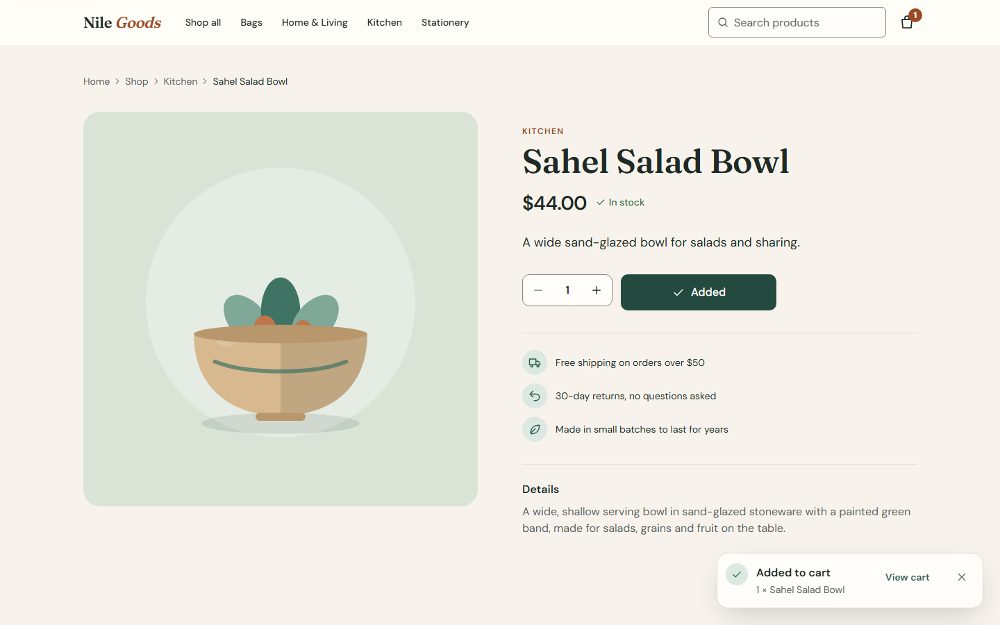
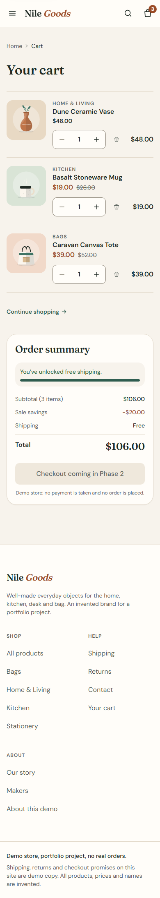
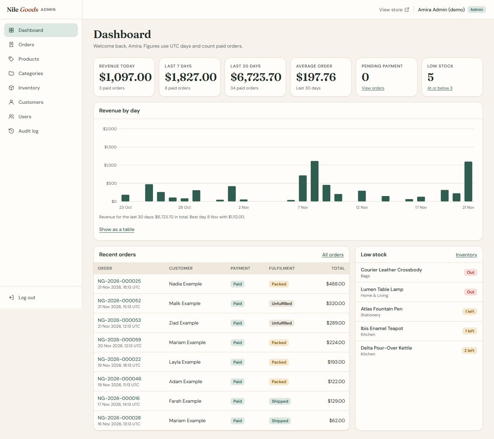
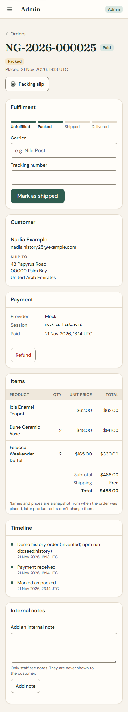

# Nile Goods: demo store (Phases 1–3)

A portfolio demo of a small home-goods shop: storefront, catalog, a server-side cart and a full
checkout with orders and payments. **Payments are mock (offline, the default) or Stripe in test mode
only; no real money ever moves.** The brand, products, prices and people are
invented, and every product image is a hand-made SVG in this repo.

Design direction: **warm, calm, editorial, crafted** (see [docs/DESIGN.md](docs/DESIGN.md)).

## Screenshots

| Product page: added to cart (desktop)                                                                | Cart (mobile, 390 px)                                                                  |
| ---------------------------------------------------------------------------------------------------- | -------------------------------------------------------------------------------------- |
|  |  |

## Admin panel (Phase 3)

A back-office at `/admin` (noindex, never cached, not linked from the store): dashboard with KPIs and an
accessible SVG revenue chart, products (image upload with magic-byte checks and EXIF stripping, archive vs
delete), categories, inventory with a stock-movement history, orders (fulfilment, tracking, notes, packing
slip, CSV export, refunds through the payment provider), customers, users and an audit log. Sign-in uses
argon2id, database sessions (30 min idle, 12 h absolute), per-IP and per-account throttling and a 15-minute
lockout after 5 failures. Every page, route and action calls `requireAdmin(role?)`; a test walks all of them.
Demo accounts get random passwords written only to the git-ignored `var/demo-credentials.txt`.

| Dashboard (desktop) | Order detail (mobile) |
| --- | --- |
|  |  |

| Area | admin | staff |
| --- | :-: | :-: |
| Dashboard, orders (view, fulfil, notes, packing slip), products (view), stock adjustments, inventory view | yes | yes |
| Create/edit/archive/delete products, categories, low-stock setting | yes | no |
| Cancel and refund orders, CSV export, customers | yes | no |
| Users, audit log | yes | no |

See [docs/HOW_TO_TEST_PHASE3.md](docs/HOW_TO_TEST_PHASE3.md) and docs/PHASE3_REPORT.md.

## What's in Phase 2: checkout, orders, payments

- **Checkout** (`/checkout`):
  - One page: contact (email) and shipping address, with correct `autocomplete` tokens. The country list
    is invented.
  - Validated on the server with zod. Errors appear in a summary and inline, clear as each field is fixed,
    and the typed values are kept.
  - The order summary sits on the right on desktop and is collapsible on top on phones.
- **Stock reservation:**
  - One database transaction re-reads prices, reserves stock with a conditional update (`stock >= qty`)
    and creates a `pending_payment` order held for 30 minutes.
  - If anything ran out, the shopper goes back to the cart with a clear message and adjusted quantities.
  - A tested race between two processes guarantees only one shopper gets the last unit.
- **Payments behind a `PaymentProvider` interface** (`src/lib/payments/`):
  - `MockProvider` (default, fully offline): a clearly labelled `/mock-pay/[sessionId]` page with Pay,
    Decline and Cancel.
  - `StripeProvider`: Stripe Checkout (hosted page) in **test mode**. Line items come from the database
    only, with a per-order idempotency key. Live keys are refused.
  - Both finish through **one webhook handler** (`/api/webhooks/payments`). Signatures are verified on
    the raw body (mock events are signed with the same Stripe helper), and duplicates are ignored via a
    `ProcessedEvent` table.
- **Orders:**
  - Human-friendly numbers (`NG-2026-000123`). Orders are reachable only through an unguessable token
    URL and are never indexed.
  - The "Confirming your payment…" page polls every 2 s for up to 30 s.
  - Decline or cancel returns to the filled-in form and releases the stock. `npm run orders:expire`
    releases abandoned reservations.
- **Confirmation "email":** written as an HTML file to `var/outbox/` (git-ignored) and viewable at
  `/dev/outbox` in development. Nothing is ever sent.
- **Security:**
  - Server actions are Origin-checked.
  - Token-bucket rate limits on checkout, mock pay and rejected webhook calls.
  - Emails are masked in logs, and Prisma query arguments are never logged.

See [docs/PHASE2_REPORT.md](docs/PHASE2_REPORT.md) and [docs/HOW_TO_TEST_PHASE2.md](docs/HOW_TO_TEST_PHASE2.md).

## What's in Phase 1

- **Home**: hero, category tiles, featured row, on-sale row, trust strip.
- **Catalog** (`/products`): filter by category, search by name, sort (newest, price ↑, price ↓) and
  pagination (12 per page). All state lives in the URL. On mobile, filters open in a bottom sheet. Includes
  a result count, skeleton loading and a "no results" state with reset.
- **Product pages** (`/products/[slug]`): breadcrumbs, sale pricing, stock badges, a quantity stepper,
  add to cart with a loading state, toast and animated badge, and related products. Unknown or inactive
  products return a real HTTP 404.
- **Cart** (`/cart`): stored on the server and keyed by a random id in an httpOnly, SameSite=Lax,
  30-day cookie. Quantities update instantly, items can be removed with undo, and there is a sticky order
  summary.
- **Quality**: keyboard-friendly (skip link, focus rings, focus-trapped mobile menu), `prefers-reduced-motion`,
  44 px touch targets, axe-clean, security headers and a strict input-validation boundary (zod; prices are
  always read from the database).

## Stack

Next.js 16 (App Router) · React 19 · TypeScript (strict) · Tailwind CSS 4 · Prisma 7 + SQLite
(better-sqlite3 driver adapter; schema kept Postgres-friendly) · zod 4 · Stripe Node SDK 23 (test mode,
optional) · Vitest 5 · Playwright 1.65 +
@axe-core/playwright · ESLint 9 + Prettier 3 · Fonts: Fraunces + DM Sans (SIL OFL, self-hosted by
`next/font`). Exact versions: [docs/PHASE1_REPORT.md](docs/PHASE1_REPORT.md#2-versions).

## Design highlights

- Linen background, river-green primary and terracotta accent. Every text pair meets WCAG AA; the ratios
  are listed in DESIGN.md.
- Serif display type (Fraunces) over a clean sans (DM Sans) on a 12–48 px scale. Headings use
  `text-wrap: balance`.
- 24 product illustrations generated from one script (`npm run illustrations`) with a shared frame,
  palette and light direction, so the catalog looks curated.
- Subtle motion (150–250 ms, one easing curve): cart badge bump, toast slide-in, drawer and sheet.
  All of it is turned off under reduced motion.

## Run it on Windows

Requirements: Node.js 22+ (developed on Node 26) and Git. Everything runs on `localhost`; nothing calls
external services.

```powershell
git clone <your-repo-url> nile-goods
cd nile-goods
git switch phase-1
npm install                      # also runs `prisma generate`
copy .env.example .env
npx playwright install chromium  # only needed for e2e tests, frames and Lighthouse
npm run db:migrate               # creates prisma/dev.db
npm run db:seed                  # 4 categories, 24 products (safe to re-run)
npm run dev                      # http://localhost:3000 (mock payments)
```

Payments default to the offline **mock** provider. A production build (`npm start`) refuses to run the
mock unless `ALLOW_MOCK_PAYMENTS="true"` and `MOCK_WEBHOOK_SECRET` are set. To try Stripe test mode with
your own sandbox keys, follow part 3 of [docs/HOW_TO_TEST_PHASE2.md](docs/HOW_TO_TEST_PHASE2.md).

npm 11 may report that some packages have install scripts. The required ones (`better-sqlite3`,
`prisma`, `@prisma/engines`, `esbuild`) are already approved in `package.json` under `allowScripts`.

## Scripts

| Command                                                       | What it does                                                                              |
| ------------------------------------------------------------- | ----------------------------------------------------------------------------------------- |
| `npm run dev` / `npm run build` / `npm start`                 | Dev server, production build, production server (localhost only)                          |
| `npm run verify`                                              | Lint → typecheck → unit → integration → build → e2e → axe (74 / 65 / 35 / 15 tests)       |
| `npm run lint` / `npm run typecheck`                          | ESLint (zero warnings) / `tsc --noEmit`                                                   |
| `npm run test:unit` / `npm run test:integration`              | Vitest; integration uses its own `prisma/test.db`                                         |
| `npm run test:e2e` / `npm run test:axe`                       | Playwright against `next build` + `next start` on port 3100 with a fresh `prisma/e2e.db`  |
| `npm run db:migrate` / `npm run db:seed` / `npm run db:reset` | Database migrations, idempotent seed, full reset                                          |
| `npm run db:prune-carts`                                      | Delete carts idle for over 30 days                                                        |
| `npm run orders:expire`                                       | Release stock held by pending orders whose 30-minute reservation has passed               |
| `npm run admin:create -- --email x@example.com --role admin` | Create an admin/staff account; prints a one-time password |
| `npm run db:seed:history`                                     | About 60 invented demo orders over 45 days for the dashboard |
| `npm run frames:phase3` / `npm run review:shots:phase3`       | Phase 3 demo frames + storyboard / admin review screenshots |
| `npm run frames:phase2`                                       | Phase 2 demo frames (mock payments) + storyboard into `evidence/phase2/`                  |
| `npm run review:shots:phase2`                                 | Review screenshots of every Phase 2 page/state (needs a running server on 3100)           |
| `npm run review:shots`                                        | Review screenshots of every page at 390×844 and 1440×900 (needs a running server on 3100) |
| `npm run frames`                                              | Demo video frames + storyboard into `evidence/phase1/` (starts its own server)            |
| `npm run lighthouse`                                          | Lighthouse mobile preset, median of 3 runs (needs a running server on 3100)               |
| `npm run illustrations`                                       | Regenerate the product SVGs                                                               |

To start the production server used by the screenshot and Lighthouse scripts:
`npx tsx scripts/e2e-server.ts` (port 3100, fresh `prisma/e2e.db`).

## Project layout

```
prisma/            schema, migrations, seed data
public/products/   24 generated SVG illustrations
scripts/           illustration generator, e2e server, frames, review shots, Lighthouse
src/app/           routes (home, products, product, cart, info), server actions, error/404 pages
src/components/    ui kit, layout, catalog, product and cart components
src/lib/           data access, cart service, orders, payments (providers, webhook), zod schemas
tests/             unit, integration (Vitest) and e2e + axe (Playwright)
docs/              design system, reports, reviews, test guide
```

## Roadmap

- **Phase 2** (done): checkout, orders, mock and Stripe test-mode payments, webhooks, outbox email.
- **Phase 3**: admin (products, stock, orders) with authentication.
- **Phase 4**: Docker + nginx + Postgres on Linux (HTTPS, `COOKIE_SECURE=true`, rate limiting,
  nonce-based CSP).

## Licence

MIT. See [LICENSE](LICENSE). Demo content (brand, products, illustrations) is invented for this project.
