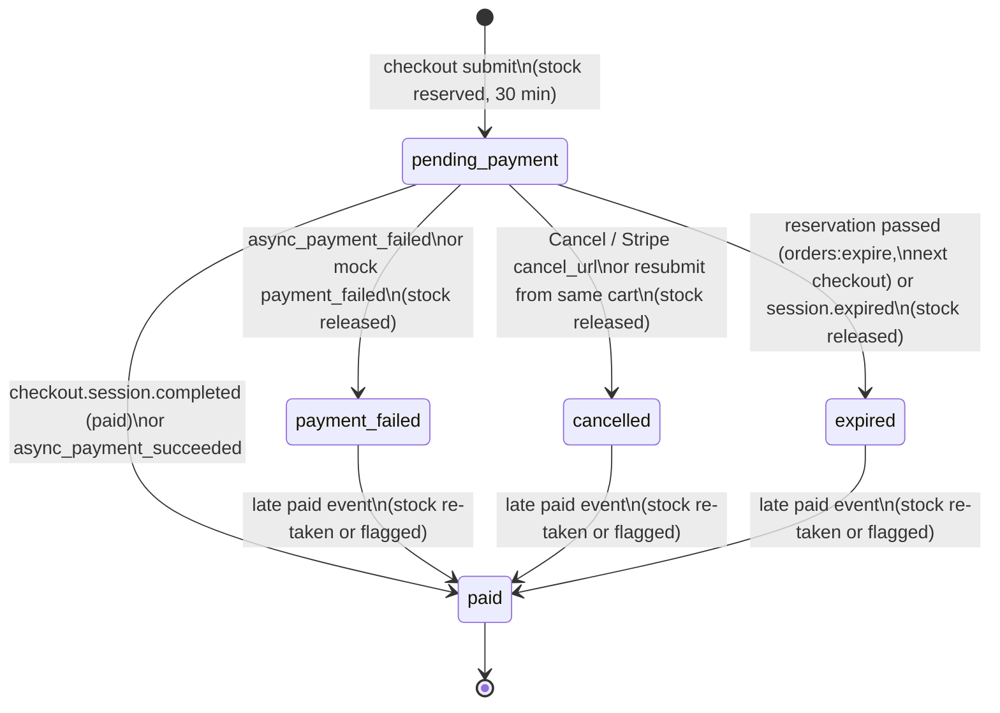

# Phase 2 report: Nile Goods checkout, orders and payments

## 1. Summary

Phase 2 adds a complete, offline-testable checkout to the Phase 1 store. All 18 checklist items in
`docs/PROGRESS_PHASE2.md` are done and committed on the local branch `phase-2`, which was branched from
`main` after the owner merged Phase 1. **Nothing was pushed or merged.**

**Checkout** (`/checkout`):

- One page with contact and shipping fields (correct `autocomplete` tokens and an invented country list).
- Server-side zod validation with an error summary and inline errors. Errors clear as fields are fixed,
  and typed values are kept.
- The order summary sits on the right on desktop and is collapsible on top on phones.

**Reservation:**

- One SQLite transaction re-reads prices, reserves stock with conditional decrements (`stock >= qty`) and
  creates a `pending_payment` order held for 30 minutes.
- A shortfall sends the shopper back to the cart, with adjusted quantities and a clear message.
- Each cart can have only one pending order: a resubmit cancels the earlier order and releases its stock.

**Payments** (`PaymentProvider`):

- `MockProvider` (the default, offline) drives `/mock-pay/[sessionId]`. That page is labelled "Mock
  payment page. No real payment provider is used." and offers Pay / Decline / Cancel.
- `StripeProvider` creates hosted Stripe Checkout sessions in **test mode**, with line items from the
  database, `client_reference_id` and metadata set to the order id, and a per-order idempotency key.
  Live keys are refused.
- `PAYMENT_PROVIDER` selects the provider. A bad configuration stops the server at startup
  (`src/instrumentation.ts`).
- The mock is off in production unless `ALLOW_MOCK_PAYMENTS=true`. When it is on, checkout and order
  pages show the "Demo mode: mock payments" ribbon.

**One shared completion path:** `/api/webhooks/payments` → `receiveWebhook` → `handleWebhook`.

- Verifies Stripe's signature over the raw body.
- Matches order id **and** stored session id, refuses live-mode events, and checks the paid amount and
  currency.
- Is idempotent through `ProcessedEvent`.
- Handles `checkout.session.completed`, `async_payment_succeeded`, `async_payment_failed`, `expired` and
  the mock's `payment_failed`.
- The mock signs Stripe-shaped events with the same helper and hands them to the same function.

**After payment:**

- The order is marked paid and the purchased items are removed from the cart.
- A confirmation "email" is written once to `var/outbox/` (git-ignored). `/dev/outbox` lists it
  (development only).
- `/order/[publicToken]` shows "Confirming your payment…" and polls every 2 s for up to 30 s, then shows
  "Thank you" with server data only.
- Decline or cancel returns to the refilled form and releases the stock. `npm run orders:expire`
  releases abandoned reservations, and the same logic runs before every checkout.

**Security:**

- Server actions are Origin-checked (CSRF). The webhook relies on its signature instead.
- Token-bucket rate limits on the checkout submit, the mock pay buttons and rejected webhook calls.
- Order pages are token-only, `noindex`, `no-referrer`. The form is refilled only for the same cart.
- Logs mask emails and never print Prisma query arguments.

**Reviews:** an independent security subagent and a design subagent each reviewed the work. Their
findings are fixed, or rejected with reasons (section 4).

**Lighthouse:** improved from 67 / 75 / 74 to 82 / 81 / 79 (home / catalog / product), default preset,
same CPU state. It does **not** reach 90 reliably on this laptop. The limits are measured in section 5.

**Demo frames** (mock payments): 31 desktop and 33 mobile frames, plus `storyboard.json` and 23 review
screenshots. All were copied to
`E:\handoff\ecommerce_phase1\phase2_evidence`, which the owner asked for instead of
`E:\handoff\ecommerce_phase2`.

## 2. Versions

Everything from Phase 1 is unchanged (see `docs/PHASE1_REPORT.md` §2). New or relevant in Phase 2:

| Tool / package                       | Version                                                             |
| ------------------------------------ | ------------------------------------------------------------------- |
| Node.js / npm                        | 26.13.1 / 11.20.0                                                   |
| **stripe** (Node SDK, new)           | **23.2.0** (`npm view stripe` latest at install; no network in use) |
| Next.js / React                      | 16.4.6 / 19.3.0                                                     |
| Prisma / @prisma/client / adapter    | 7.10.1 (two new migrations)                                         |
| zod / Vitest / Playwright / axe-core | 4.6.7 / 5.1.1 / 1.65.1 / 4.14.0                                     |
| Lighthouse                           | 13.6.0                                                              |
| SQLite access in E2E helpers         | Node's built-in `node:sqlite` (read-only stock checks)              |

## 3. Results

### `npm run verify` (final run, step 18)

| Stage                                       | Result                                       |
| ------------------------------------------- | -------------------------------------------- |
| Lint (`eslint --max-warnings=0`)            | pass, 0 problems                             |
| Typecheck (`tsc --noEmit`)                  | pass                                         |
| Unit (Vitest)                               | **74 / 74 passed** (7 files; Phase 1 had 35) |
| Integration (Vitest, `prisma/test.db`)      | **65 / 65 passed** (3 files; Phase 1 had 35) |
| Build (`next build`)                        | pass; all routes dynamic                     |
| E2E (Playwright, mock provider, production) | **35 / 35 passed** (29 desktop, 6 mobile)    |
| Axe (WCAG 2.0/2.1/2.2 A+AA + best practice) | **15 / 15 passed**, 0 serious/critical       |

What the new suites cover:

- **Unit:**
  - Provider selection rules: default mock, mock off in production without the flag, the mock secret
    required in production, Stripe without keys fails fast, live keys refused, unknown provider.
  - Webhook signature verification: valid, missing header, wrong secret, tampered body, re-serialised
    body, replay outside tolerance, wrong shape.
  - The Stripe provider with the SDK mocked: line items, shipping line, idempotency key, expiry,
    cancellation, a missing URL.
  - Order number format, tokens, shipping rule ($5.95 under $50) and the checkout schema.
  - The idempotency guard (with a fake database), log masking, the rate limiter, email escaping, and
    the outbox filename guard.
- **Integration:**
  - Reservation with server-side totals and sequential order numbers.
  - Empty cart. Stock shortfall returning to the cart with adjusted quantities.
  - **The race: two separate OS processes checking out the last units, where exactly one wins.** Also
    ten shoppers on one connection.
  - Price tampering: a price change after adding to the cart is ignored, and extra form fields are
    dropped.
  - Paid, async, failed, expired and cancelled transitions, with stock released exactly once.
  - Expiry, including before a new checkout. A late payment after expiry, including oversold.
  - Mismatched session, duplicate events, a second paid event, and a failure after payment.
  - `handleWebhook` end-to-end with signatures and a single email.
  - Security fixes: one pending order per cart; amount, currency and livemode checks; unmatched events
    not recorded; retry before the session is stored; partial cart clearing; fulfilment flag.
- **E2E (mock):**
  - Full purchase: reserved → paid, success page, refresh, cart cleared, stock reduced, outbox file.
  - Decline (form refilled, stock released, retry works). Cancel. Back-and-resubmit (no double hold).
  - Validation errors (summary focused, inline, cleared on edit, values kept).
  - Autocomplete and input types. Sold out between cart and checkout (two browser contexts).
  - Keyboard-only checkout. Mobile checkout (summary on top, no overflow, 44 px targets).
  - Guards: empty cart, 404 for unknown tokens and sessions, the webhook rejecting unsigned or forged
    calls (and 405 on GET), `/dev/outbox` 404 in production, `noindex` on checkout, pay and order pages.
- **Axe:** checkout (empty and with errors), the mock pay page, the order page (pending and paid), and on
  a phone the checkout with the summary open and the cancelled notice.

### Order state diagram



Events for a paid order never move it back. Stock is released only on the single transition out of
`pending_payment`.

## 4. Reviews

### 4.1 Visual self-review loop (step 12)

`npm run review:shots:phase2` captures 23 screenshots in `evidence/phase2/review`: every new page and
state at 390×844 and 1440×900. Two rounds; each finding was fixed:

- The demo ribbon icon floated apart from its wrapped text on mobile. It is now inline.
- The mock pay page showed an odd background band above the footer. The wrapper was removed.
- Order numbers wrapped mid-token. They now use `whitespace-nowrap`.
- The "Confirming" page showed two spinners. Now there is one.
- The mobile "Thank you" heading was oversized. It is now `text-2xl` on phones.
- Error-summary bullets were misaligned on wrapped lines. The list was then redesigned in 4.3.

The screenshots were re-taken after the design-review fixes.

### 4.2 Security review subagent (step 13)

Full table: `docs/reviews/phase2-security-review.md`. 12 findings, no critical. The reviewer confirmed
server-side prices, conditional stock updates, raw-body signatures, transactional idempotency,
unguessable tokens and Host-independent redirects. Fixed:

- One pending order per cart, which stops stock being held twice or two payable sessions existing.
- The webhook rate limit now applies only after a signature fails, so junk cannot throttle real events.
- Unmatched events are not recorded. An event that arrives before the session id is stored gets a
  retry (500).
- Paid amount, currency and livemode are checked.
- Late and oversold payments are stored in `Order.fulfilmentNote` and logged.
- Paying removes only the purchased items from the cart.
- Cancel requires the order's own cart cookie.
- The webhook body is read with a byte cap.
- Error logs are sanitised everywhere.
- The dev mock secret is random per process.
- Mixed-currency carts are refused.

Mitigated and documented: the SQLite adapter limitation (see 6). Deferred: per-IP rate limiting, which
belongs in nginx in Phase 4.

### 4.3 Design and UX review subagent (step 14)

Full table: `docs/reviews/phase2-design-review.md`. 10 findings: 7 fixed, 2 mostly fixed, 1 rejected.
Fixed:

- Errors clear live as fields are edited.
- Decline copy says "declined, nothing charged, details saved", and the button reads "Try payment again".
- The cart badge syncs after a stock adjustment, and a single sold-out product is named.
- The "Confirming" page shows the total, and mock orders show the ribbon.
- A "Sale savings" row was added to the checkout summary.
- The error summary is compact (a count plus field links).
- A 44 px "Edit cart" link appears in both summaries, and the duplicate quantity badge was removed.
- The mock page lost its developer text and accent banner.
- The confirmation label uses the success colour, and a "What happens next" block was added.

Rejected: a reduced checkout header and footer. It is kept for continuity, and noted for Phase 3.

## 5. Lighthouse (step 15)

Details: `docs/reviews/phase2-lighthouse.md`. Default mobile preset, production build, median of 3 runs,
**no CPU calibration**.

| Page    | Perf before | Perf after | TBT before → after | LCP before → after | A11y / BP / SEO | CPU benchmark |
| ------- | ----------- | ---------- | ------------------ | ------------------ | --------------- | ------------- |
| Home    | 67          | **82**     | 1,240 → 440 ms     | 3.4 → 3.2 s        | 100 / 100 / 100 | ≈ 760 / 758   |
| Catalog | 75          | **81**     | 660 → 460 ms       | 3.4 → 3.3 s        | 100 / 100 / 100 | ≈ 746 / 754   |
| Product | 74          | **79**     | 760 → 550 ms       | 3.3 → 3.2 s        | 100 / 100 / 100 | ≈ 766 / 745   |

**Changes:**

- Fraunces now loads one static weight (600) instead of the full variable font: 18 KB instead of 37 KB on
  the critical path.
- The mobile menu drawer is loaded on demand instead of being hydrated on every page.

**Why 90 is not reached here** (measured):

1. **This laptop's CPU.** Its `benchmarkIndex` is about 750 while thermally throttled and about 1,700 when
   cool. The same home page scored 91 at 1,708 with no code change.
2. **React's fixed runtime cost.** At about 750, the React DOM chunk alone is about 760 ms of scripting
   under 4× slowdown. Blocking all JS in the same state gives **99**, with TBT at 40 ms and LCP at 2.0 s,
   so what remains between the scores is framework JavaScript.
3. **The simulated LCP** (3.0–3.2 s) is the JS critical path over simulated slow 4G. The LCP element
   itself is a 1 KB SVG that renders in about 0.5 s observed.

## 6. Known issues, Blocked, Needed permissions

### Known issues

- **Stripe is untested against the real service.**
  - No keys were available during the run, as the rules required. The Stripe code is covered with a
    mocked SDK and real signed payloads (`generateTestHeaderString`).
  - The owner's own test-mode run is part 3 of `docs/HOW_TO_TEST_PHASE2.md`.
- **SQLite driver adapter.**
  - `@prisma/adapter-better-sqlite3` serialises interactive transactions on one connection, but plain
    queries share that connection. A plain write issued while another request's transaction is open
    becomes part of that transaction.
  - Mitigation: all Phase 2 writes now run inside transactions, and the checkout never relies on
    rollbacks (it writes compensating updates instead).
  - Phase 1 cart writes still use the adapter as before. Phase 4 (Postgres) removes the issue.
- **Rate limits are per process and per cart.** Per-IP limits apply only behind a trusted proxy
  (`TRUST_PROXY=true`). Real per-IP limits move to nginx in Phase 4.
- **Production start needs payment config.** `npm start` refuses the mock without
  `ALLOW_MOCK_PAYMENTS=true` and `MOCK_WEBHOOK_SECRET`. This is by design, so a misconfigured server
  fails fast.
- **`APP_URL` must match where the app is served.** It is a new runtime variable used for Stripe return
  URLs, redirects and email links. `NEXT_PUBLIC_SITE_URL` is frozen at build time, so it cannot be used.
- **Outbox files hold demo personal data.** `var/outbox/*.html` contains the invented names and addresses.
  The folder is git-ignored and local. Delete it with `rm -rf var/outbox`. Phase 4 would replace it with a
  real mailer.
- **"Free over $50" includes $50.00 exactly**, consistent with Phase 1's cart.
- **Lighthouse performance is below 90 on this laptop** (section 5).
- **Design items deferred:** a reduced checkout chrome (Phase 3). The address format stays
  "postcode town".
- **The settings file was replaced as asked.** `.claude/settings.json` was replaced by the owner's
  `phase2_setup/settings.json` and committed in the first Phase 2 commit.
- **An untracked owner file sits in the repo root.** `push_phase1.bat` was left untouched and was not
  committed.

### Blocked

None.

### Needed permissions

None. No step needed a command outside `.claude/settings.json`. `curl` is denied, so the scripts use
Node's `fetch` for local health checks.

## 7. Privacy check (step 18)

Run in Git Bash from the project root after the final verify:

```bash
# 1. Stripe keys or webhook secrets in tracked files (live or test)
git ls-files -z | xargs -0 grep -nIE "sk_(live|test)_[A-Za-z0-9]{8,}|rk_(live|test)_[A-Za-z0-9]{8,}|whsec_[A-Za-z0-9]{8,}|pk_live_"
#    -> no output

# 2. Email addresses other than the invented @example.com ones (package scopes excluded)
git ls-files -z | xargs -0 grep -nIoE "[A-Za-z0-9._%+-]+@[A-Za-z0-9.-]+\.[A-Za-z]{2,}" \
  | grep -vE "@example\.com|@types/|@prisma/|@axe-core|@playwright|@tailwindcss|@vercel|noreply@anthropic\.com|@[0-9]"
#    -> tests/unit/orders.test.ts: Mona@Example.com  (the same demo address, testing lower-casing)

# 3. Windows user paths, the machine's user name and the owner's real name (patterns not repeated here)
git ls-files -z | xargs -0 grep -nIiE "C:\\\\Users|C:/Users|AppData|<user name>|<real name>"
#    -> no output (outside this report and the Phase 1 report, which only show these commands)

# 4. Env, database or outbox files tracked by git
git ls-files | grep -E "\.env|\.db$|outbox"
#    -> .env.example (placeholders only) and three source files named "outbox"; no data files

# 5. Evidence and handoff folders (storyboard, Lighthouse JSON/HTML): paths, names, keys
for d in evidence/phase2 /e/handoff/ecommerce_phase1/phase2_evidence; do
  grep -rlIiE "C:\\\\Users|C:/Users|AppData|<user name>|<real name>|sk_(live|test)_[A-Za-z0-9]{8,}|whsec_[A-Za-z0-9]{8,}" "$d"
done
#    -> no output for either folder

# 6. The machine's hostname in repo, evidence or handoff
git ls-files -z | xargs -0 grep -nIi "$(hostname)"; grep -rlIi "$(hostname)" evidence/phase2 /e/handoff/ecommerce_phase1/phase2_evidence
#    -> no output
```

Results:

- **No secrets anywhere.** No `sk_live`, `sk_test`, `rk_` or `whsec_` values appear in the repo,
  evidence or frames. `.env.example` has empty Stripe placeholders. The unit tests build their fake key
  strings at runtime, so no key-shaped literal exists in the source.
- **Only invented people.** Every customer is a demo identity at `@example.com` (Mona Example, Omar
  Example, Race Example), with invented addresses and countries. The frames and screenshots show only
  the demo site: page content, no browser chrome, no file paths.
- **Personal data stays in ignored local folders.** Outbox emails and SQLite databases are under
  git-ignored paths (`var/`, `prisma/*.db`).
- **One thing to know:** the Phase 2 commits are authored with your global git identity, as in Phase 1.

## 8. Commits

`phase-2`, on top of `main` (19e0ca9 "Merge branch 'phase-1'"), oldest first:

```
07c2457 chore: start phase 2 (prompt, progress checklist, updated agent settings)
b162a51 feat(db): order, order item, processed event and order counter models; payment env vars
12b1290 feat(payments): provider interface, mock and Stripe Checkout providers, config rules, signed events
613cca5 feat(payments): webhook route with signature verification and idempotency; order service, outbox, rate limiter
8de1afb feat(checkout): checkout page with server-validated form, order summary and cancel route
e5250c0 feat(orders): npm run orders:expire releases stale reservations
c140531 feat(checkout): mock pay page, order page with status polling, outbox email and dev outbox
8ffebbf fix(security): sanitized error logging, catch order creation failures
dd28d81 test: unit tests for orders, checkout schema, idempotency guard and security helpers
9448a80 test(e2e): checkout journeys with the mock provider, mobile and keyboard checkout, axe on new pages
4ffb143 fix(ui): visual self-review fixes for checkout, mock pay and order pages; phase 2 review screenshot script
a4ba127 fix(security): apply phase 2 security review findings
b4d8ce0 fix(ui): apply phase 2 design review findings (live error clearing, decline copy, savings row, badge sync, mock page copy)
98cb21a perf: single-weight display font, lazy-loaded mobile menu; phase 2 Lighthouse before/after
ee5c94b feat(demo): phase 2 frame recorder and storyboard (mock payments)
595ff1e docs: phase 2 report, home test guide (Git Bash, Stripe test mode) and README
(final)  chore: privacy check, final verify, report sections 7-8   <- this commit
```

Nothing was pushed or merged. The push and merge commands for you are in `docs/HOW_TO_TEST_PHASE2.md`,
step 36.
